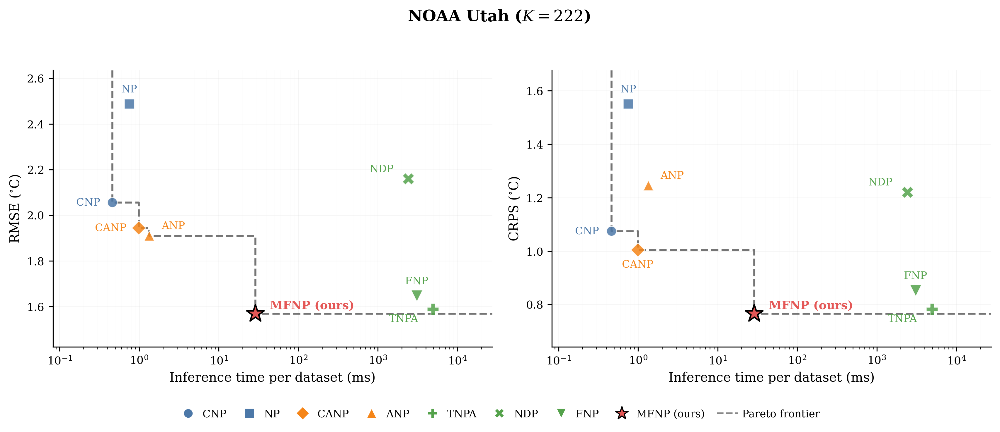
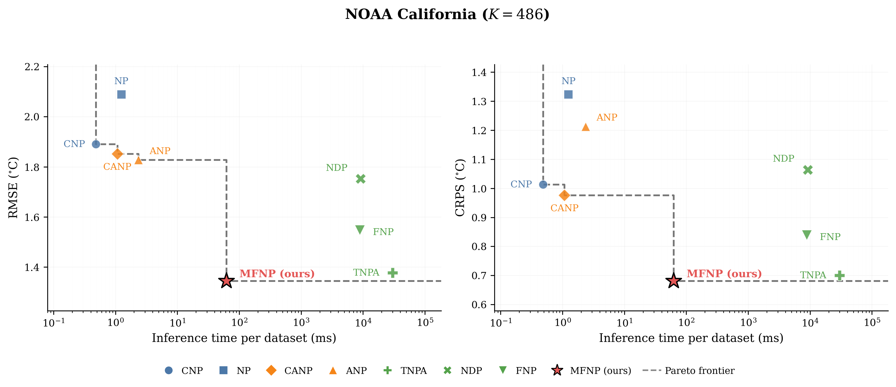
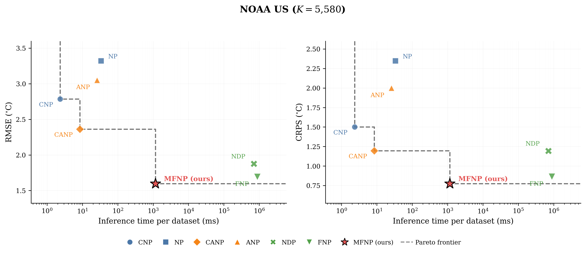
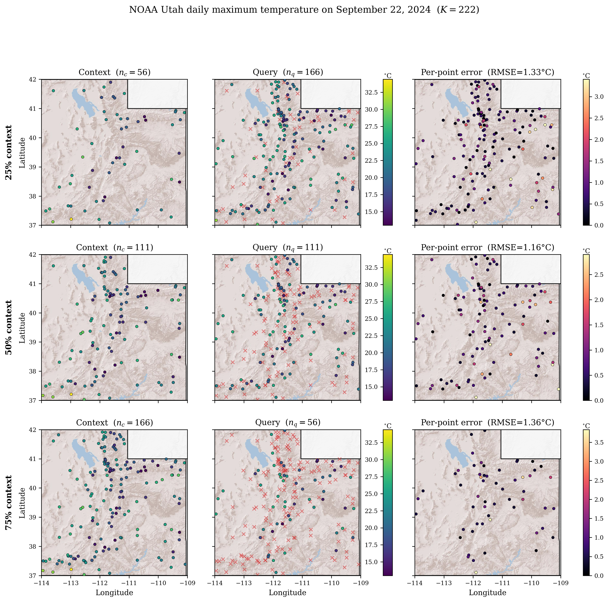
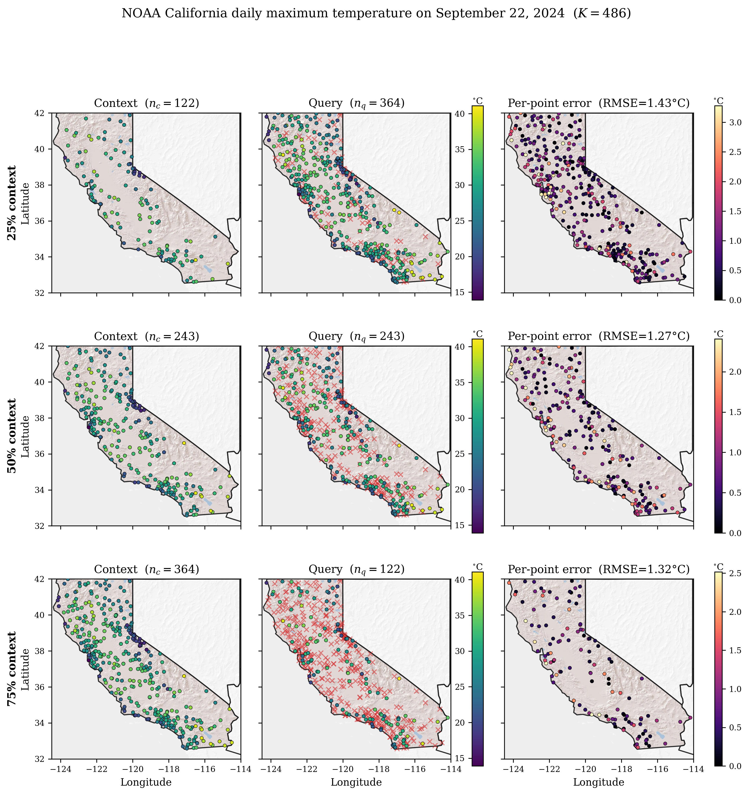
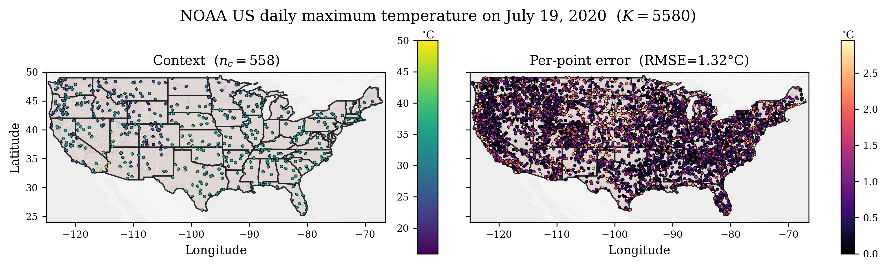
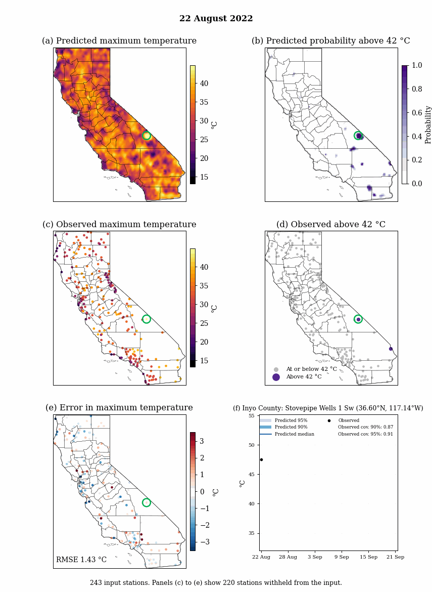

# MambaFlowNP

Code and pretrained weights for MambaFlowNP (NeurIPS 2026).

MambaFlowNP predicts a spatial field at query locations from observations at context locations
and returns joint samples. Points are ordered along jittered Hilbert curves and processed by
distance-aware Mamba-2 layers. Context points write to the scan state and query points only read
it. All randomness shared between queries is one latent vector per sample, so each sample is the
values of one random function of the context. Predicting a map in chunks, or adding query points,
leaves every sample unchanged. The model is trained with flow matching, distilled into a one-step
sampler with reflow, and fine-tuned on the continuous ranked probability score (CRPS) of its own
samples.

## Installation

The data files are stored with Git LFS. Run `git lfs install` before cloning.

```bash
pip install -r requirements.txt
pip install "jax[cuda12]==0.9.0.1"  # NVIDIA GPU
```

Tested with Python 3.14.

## Repository layout

| Path | |
|---|---|
| `mambaflownp/` | Model, sampling, training and data code |
| `train.py` | Training |
| `evaluate.py` | Evaluation |
| `reproduce.sh` | Evaluates the released weights on Utah, California and US and renders the figures |
| `weights/` | Weights for Utah, California and US |
| `data/` | NOAA daily maximum temperature for Utah, California and US |
| `figures.py`, `plotting/` | Figures in `results/` |
| `results/` | Evaluation results and figures |
| `tests/` | Tests |

## Inference

```python
import jax

import mambaflownp as mf
from mambaflownp import noaa

region = noaa.Region(noaa.data_path("california"))
model = noaa.load_model("california")

# 243 context and 243 query stations on one test day, with values in normalised units.
x_ctx, y_ctx, x_qry, y_qry = region.sampler("test", seed=0).sample(1, 243, 243)
keys = jax.random.split(jax.random.PRNGKey(0), 128)
samples = region.normalizer.inverse(mf.sample(model, x_ctx, y_ctx, x_qry, keys)[..., 0])
# samples: (128, 243) in °C
```

Each key fixes one sample of the random function. Calling `mf.sample` with the same keys on any
set of queries, whole or in chunks, returns the values of the same samples.

Coordinates are in `region.coords` units. Longitude and latitude are mapped to these units with
`mf.CoordFrame.fit(region.lonlat).transform(lonlat)`, and values in °C with
`region.normalizer.transform`.

## Evaluation

```bash
./reproduce.sh
```

runs

```bash
python evaluate.py --region utah --out results/utah
python evaluate.py --region california --out results/california
python evaluate.py --region us --out results/us --draws-per-call 16
python figures.py
```

Each of 10 seeds evaluates 1024 test tasks with 128 samples per task. Context and target points
are split equally: 111 each for Utah, 243 each for California and 2790 each for the US. The model
draws 16 samples from each of 8 scan-grid shifts.

`python figures.py` renders the maps and the latency against RMSE and CRPS figures in `results/`
from the released weights and the results above.

## Training

```bash
python train.py --region utah --out runs/utah
python train.py --region california --out runs/california
python train.py --region us --out runs/us
```

| | Utah | California | US |
|---|---|---|---|
| Hidden size | 128 | 256 | 256 |
| Layers | 6 | 6 | 6 |
| State size | 16 | 16 | 16 |
| Fourier frequencies | 256 | 192 | 384 |
| Fourier scale | 0.25 | 0.25 | 0.25 |
| Scan-grid shifts | 8 | 8 | 8 |
| Points per task | 222 | 486 | 5580 |
| Batch size | 16 | 16 | 8 |
| Learning rate | 1.0e-3 | 1.52e-3 | 1.0e-3 |
| Flow-matching steps | 80,000 | 80,000 | 80,000 |
| Reflow couplings | 5,000 | 5,000 | 1,000 |
| Reflow steps | 20,000 | 20,000 | 20,000 |
| CRPS batch size | 8 | 8 | 2 |
| CRPS samples per task | 8 | 8 | 4 |

AdamW with a weight decay of 1.0e-4, 100 warmup steps, cosine decay, gradient clipping at 1.0
and an EMA decay of 0.9995; steps with non-finite gradients are skipped. Reflow couplings are
generated with 10 Heun steps of the teacher. The model is then fine-tuned on the CRPS with a
learning rate of 1.0e-4 at 8 tasks per batch, scaled with the square root of the batch size. The
CRPS is measured on 64 validation tasks every 1,000 steps; training stops after 5 measurements
without improvement, or at 40,000 steps, and keeps the best weights. The Utah and California
models were trained on one NVIDIA L40S and the US model on one NVIDIA RTX PRO 5000 Blackwell.

## Data

NOAA GHCN-Daily (<https://www.ncei.noaa.gov/pub/data/ghcn/daily/>) daily maximum temperature.
Training: 2005 to 2016. Validation: 2017 to 2019. Test: 2020 to 2024.

| Region | Stations | Train / validation / test days |
|---|---|---|
| Utah | 255 | 4383 / 1095 / 1827 |
| California | 523 | 4383 / 1095 / 1827 |
| US | 5943 | 4383 / 1095 / 1827 |

Each file contains `station_ids`, `lonlat`, `coords` (unit square), `tmax` (°C, NaN if missing),
`dates`, `train_idx`, `val_idx`, `test_idx`, and the quantile transform `qt_raw`, `qt_z`,
`qt_z_unique` and `qt_raw_unique`.

## Results

Test set, mean ± standard error over 10 seeds.

| Region | RMSE (°C) | CRPS (°C) | 90% coverage | 95% coverage |
|---|---|---|---|---|
| Utah | 1.570 ± 0.005 | 0.767 ± 0.002 | 0.903 ± 0.000 | 0.940 ± 0.000 |
| California | 1.344 ± 0.002 | 0.681 ± 0.001 | 0.911 ± 0.000 | 0.945 ± 0.000 |
| US | 1.598 ± 0.003 | 0.774 ± 0.001 | 0.926 ± 0.002 | 0.955 ± 0.001 |

Baseline results are listed in `results/baselines.csv`.













### California heat wave, September 2022

MambaFlowNP maps on test days, with half of the stations as context.



## Tests

```bash
JAX_PLATFORMS=cpu python -m pytest tests
```

## Citation

```bibtex
@inproceedings{santoni2026mambaflownp,
  title     = {Mamba Flow Matching Neural Processes: Linear-Time Inference for Irregularly
               Observed Spatial Fields},
  author    = {Santoni, Cosmo and Charles, Giovanni and Hitge, Timothy James and
               Watson, Oliver John and Semenova, Elizaveta},
  booktitle = {Advances in Neural Information Processing Systems},
  year      = {2026}
}
```

## License

Apache License 2.0. See `LICENSE`.
